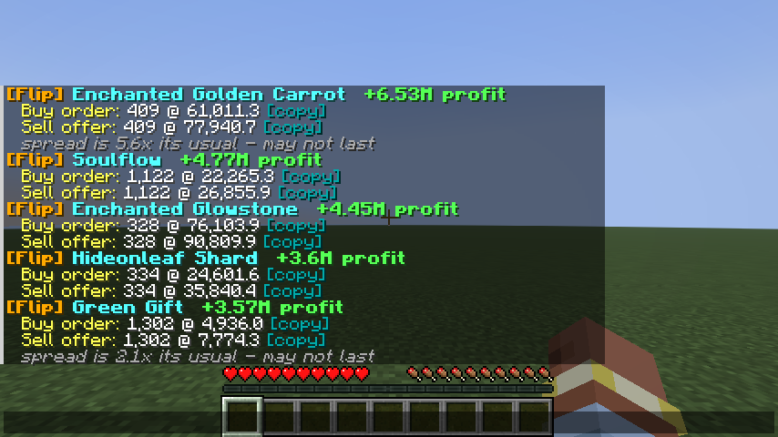

# Bazaar Flipper (alerts only)

Pings you **in Minecraft chat** as soon as a Hypixel SkyBlock Bazaar flip is worth doing. Each alert tells you what to buy, the exact buy order and sell offer prices, how many, and the profit after tax.

- Click **[copy]** to copy that exact price, then paste it into the custom price sign.
- Hover the item name for details. Click it to open `/bz <item>`.
- An alert sound plays on new flips. Turn it off with `/flips sound`.

There are two ways to use it:

| | What it is | Alerts go to |
|---|---|---|
| **The mod** (`mod/`) | Fabric mod for **Minecraft 26.1.2**. Runs on its own, no Python needed | Your chat, plus a sound |
| **The script** (`flipper.py`) | Python script you run in a window | The console, and optionally Discord (handy on your phone) |

Both use the same maths and filters. Use either one, or both.

## Hypixel rules: it only alerts you
Neither one **places orders, clicks, opens menus or automates the game**. Automating the Bazaar is a macro and gets accounts banned. Both only read Hypixel's public Bazaar prices and show you text. You still go to the Bazaar and place every order yourself. The one thing the mod ever sends to Hypixel is a `/bz` command, and only when you click an item name.

## The mod

### Install
1. Get `bazaarflipper-1.0.0.jar` from Modrinth, or build it yourself: open a terminal in `mod/` and run `gradlew build`. The jar lands in `mod/build/libs/`.
2. In the Modrinth app, open a **Fabric 26.1.2** profile and use **Add content → from file** to add the jar. Also add **Fabric API** if the profile doesn't have it.
3. Join Hypixel. The first alerts arrive within about 20 seconds.

### How fast are the alerts?
Hypixel refreshes Bazaar prices about every 20 seconds. The mod checks every 20 seconds. If it catches the data just before a refresh, it checks again 5 seconds later. A new flip usually reaches your chat within 20 to 25 seconds of the prices changing. An item only alerts again if its prices move more than 3% or 30 minutes have passed.

### Commands
| Command | What it does |
|---|---|
| `/flips` | Show the current best flips |
| `/flips on` / `/flips off` | Pause or resume alerts |
| `/flips sound` | Turn the alert sound on or off |
| `/flips settings` | Show your settings |
| `/flips set <setting> <value>` | Change a setting, e.g. `/flips set budget 50m` or `/flips set minProfitPerFlip 500k` |
| `/flips reload` | Reload settings after editing the file by hand |

Settings are saved in `.minecraft/config/bazaarflipper.json`. Edit the blacklist there, e.g. `"blacklist": ["GREEN_GIFT"]`.

## The script (console + Discord)
1. Install Python 3.8+ from https://www.python.org and tick **"Add python.exe to PATH"**. No extra packages are needed.
2. Double-click **`run.bat`**, or run `python flipper.py`. Keep the window open.
3. Optional: paste a Discord webhook URL into `discord_webhook` in `config.json` to get alerts on Discord. Get the URL from your channel's settings → Integrations → Webhooks.

`config.json` is created on first run and re-read on every check, so you don't need to restart after editing. `python flipper.py --once` does a single check and exits.

## Settings
In the mod, settings use the camelCase names, e.g. `minProfitPerFlip`. In `config.json` they use snake_case, e.g. `min_profit_per_flip`.

| Setting | Default | Meaning |
|---|---|---|
| poll seconds | 20 | How often to check (minimum 10 in the mod, 20 in the script) |
| budget | 100M | Max coins across all suggestions at once |
| max coins per flip | 25M | Max coins in any single flip |
| min profit per flip | 300k | Skip flips that make less than this in total |
| min margin percent | 2.0 | Skip flips with a smaller margin than this, after tax |
| min weekly volume | 200k | Skip items with fewer instabuys or instasells per week than this, so you don't get dead items |
| max share of hourly volume | 0.25 | Suggest at most 25% of what trades per hour, so orders actually fill |
| tax percent | 1.25 | Bazaar tax on sell offers. Set **1.125** or **1.0** if you have the Bazaar Flipper upgrade from the Community Shop |
| top n | 5 | How many flips to suggest per check |
| realert minutes | 30 | Don't repeat the same item sooner than this, unless its prices move more than 3% |
| outlier factor | 1.5 | Skip an item if its sell price is more than 1.5x its 24h median (likely manipulated) |
| use coflnet | true | Use [Coflnet](https://sky.coflnet.com)'s 24h price history. If it's off or Coflnet is down, the price history recorded since startup is used instead |
| blacklist | [] | Item IDs to never suggest |
| discord webhook | "" | Script only. Discord webhook URL |
| beep | false | Script only. Beep in the console on new alerts |

## How the numbers are worked out
- **Buy order price** = current top buy order + 0.1. **Sell offer price** = current lowest sell offer - 0.1.
- **Profit per item** = sell price × (1 - tax) - buy price. Buy orders have no tax.
- **Quantity** is the smallest of four limits: max coins per flip, your share of hourly volume, what's left of the budget, and the Bazaar's 71,680 per-order limit.
- **Volume** is the slower side of the flip. Your buy order fills when people insta-sell, and your sell offer fills when people insta-buy.
- A grey **note** shows when the spread is much wider than usual. That flip may be gone in minutes.

## Tips
- Prices move. Before you place an order, check that you'd still be top of the order book. If someone outbids you, wait for the next alert or use `/flips`.
- Start with a small budget until you trust the suggestions.

## Development
In `mod/`:
- `gradlew build` builds the jar and runs the unit tests.
- `gradlew runClientGameTest` opens a real 26.1.2 client, waits for live alerts to reach chat and saves a screenshot to `build/run/clientGameTest/screenshots`. It needs internet.

`MODRINTH.md` has the text for the Modrinth listing.

License: MIT.
